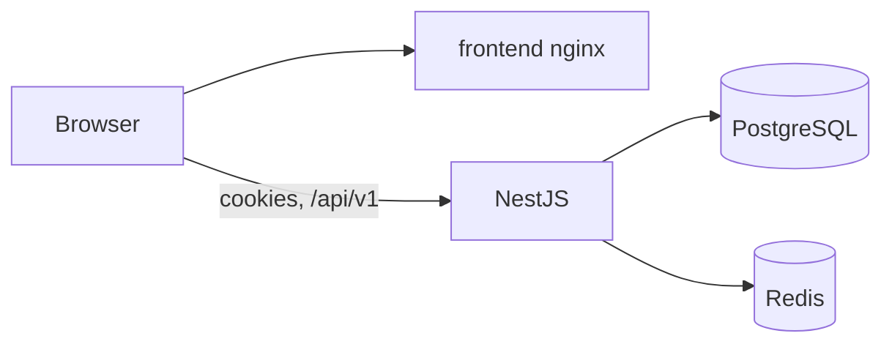
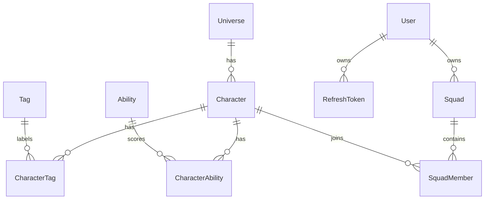

# Squad of Champions

Fullstack solution to the 360 VUZ "Squad of Champions" challenge: build a squad
of up to six fighting-game characters to defend Earthrealm.

## Repository layout

```
frontend/   React + Redux Toolkit + TypeScript app (Vite, MUI, Feature-Sliced Design)
backend/    NestJS API (PostgreSQL, Redis)
```

## Run

```bash
cp .env.example .env
docker compose up -d --build
```

That starts PostgreSQL, Redis, the API, and the squad screen. The API container applies migrations and seeds the characters before it listens. The frontend container is nginx serving the Vite build

- App: http://localhost:5173
- API: http://localhost:3000/api/v1
- Health: http://localhost:3000/health
- Swagger: http://localhost:3000/api/docs
- Postman: [postman/squad-of-champions.postman_collection.json](postman/squad-of-champions.postman_collection.json)

Import the collection and send **List characters**, then **Register**, then the squad requests in order. Postman keeps the session cookies. Register generates a new email on every send.

## Architecture



The page and the API are different ports on localhost, which is still one site for `SameSite=Strict`. The access cookie is sent only to `/api/v1`. The refresh cookie is sent only to `/api/v1/auth`.



`Character.id` is the id from the source JSON, not a sequence. `Character.name` has a trigram GIN index for the search. `SquadMember` is unique on `(squadId, characterId)`. A refresh token row stores the SHA-256 of the cookie, not the cookie itself.

## Decisions

The catalogue is paged with a keyset cursor because the screen only asks for the next page. List and filter responses are cached in Redis for 10 minutes under `chars:version`, which the seed increments. `GET /characters/:id` and `GET /characters/by-ids` are not cached: each is a primary-key read of at most six rows, and the squad's id set changes on every edit

Auth screens were not specified, so login and register share one form. React Hook Form and Zod keep validation in a schema. A duplicate email is `409` `EMAIL_TAKEN`. Login uses `401` `INVALID_CREDENTIALS` for both an unknown email and a wrong password

The design has no squad name, and the API requires one, so the first checked character creates a squad named `My team`. The screen uses the oldest squad. `My Team` is a separate control: it shows only that squad and says so. Search waits 300ms, then matches a name or a tag on the server

## API

### Characters

| Method | Path                         | Behaviour                                                                                                                                                                                                                                                                                                                        |
| ------ | ---------------------------- | -------------------------------------------------------------------------------------------------------------------------------------------------------------------------------------------------------------------------------------------------------------------------------------------------------------------------------- |
| GET    | `/api/v1/characters`         | One page. Query: `search` (case-insensitive substring of the name or of any tag; `grapple` also matches the tag `grappling`), `tags` (comma-separated, a character matches if it has any of them), `universe` (narrows the page), `limit` (1–100, default 20), `cursor`, `sort` (`name` or `id`). Body: `{ items, nextCursor }`. |
| GET    | `/api/v1/characters/filters` | Tag names in first-appearance order, then universe names. `grapple` and `grappling` stay separate.                                                                                                                                                                                                                               |
| GET    | `/api/v1/characters/by-ids`  | Several characters in one response, in the requested order, with tags and abilities. Query `ids` is 1–6 unique comma-separated ids. A bad list is `400` and `VALIDATION_ERROR`. An unknown id is `404` and `CHARACTER_NOT_FOUND`. Not cached.                                                                                    |
| GET    | `/api/v1/characters/:id`     | One character. Unknown id: `404` and `CHARACTER_NOT_FOUND`.                                                                                                                                                                                                                                                                      |

A cursor that cannot be decoded is `400` and `VALIDATION_ERROR`. `quote` and `thumbnail` are `null` when the source JSON has no value

#### Why a cursor

The squad builder asks for the next page while the user scrolls. It never jumps to page 12. A cursor is the last row of the current page (`name` and `id`, or only `id` when `sort=id`) and the next query asks for rows strictly after that point. A row inserted or deleted above the page does not shift the rows the client has already seen, and PostgreSQL uses the `(name, id)` index instead of walking past skipped rows with `OFFSET`

#### Cache

The catalogue changes only when the seed runs. The seed increments `chars:version`. Every cache key starts with that version:

- list: `chars:v{version}:name-or-tag:{sha1 of the normalized query}`
- filters: `chars:v{version}:filters`

The hash covers search, tags, universe, limit, cursor and sort. Tags are sorted before hashing, so `robot,alien` and `alien,robot` are the same request

Each entry lives for 10 minutes. Invalidation is the version counter. After a new seed `chars:version` no longer matches, so old keys are never read and expire on their own. The catalogue has no write API, so nothing else needs to invalidate it

### Auth

| Method | Path                    | Behaviour                                                                                    |
| ------ | ----------------------- | -------------------------------------------------------------------------------------------- |
| POST   | `/api/v1/auth/register` | Creates a user and starts a session. Body: `{ email, password }`. Response: `{ id, email }`. |
| POST   | `/api/v1/auth/login`    | Starts a session for an existing user. Same body and response.                               |
| POST   | `/api/v1/auth/refresh`  | Rotates the refresh cookie and sets a new access cookie.                                     |
| POST   | `/api/v1/auth/logout`   | Revokes the current refresh token and clears both cookies.                                   |
| GET    | `/api/v1/auth/me`       | The user for the access cookie.                                                              |

The challenge does not say what registration should do when the email is already taken. This API answers `409` and `EMAIL_TAKEN`. Login answers `401` and `INVALID_CREDENTIALS` both for an unknown email and for a wrong password, so login cannot be used to discover which addresses exist.

Both tokens are `httpOnly` and `SameSite=Strict` cookies. The response body never contains them. The access cookie is a 15-minute JWT, path `/api/v1`. The refresh cookie is a random value stored only as a SHA-256 hash, path `/api/v1/auth`, and it lasts 30 days. After a reload the browser sends the access cookie with `GET /auth/me`. When that cookie has expired, `POST /auth/refresh` sends the refresh cookie and replaces both. A refresh token that was already rotated revokes every session of that user.

### Squads

Every squad route requires the access cookie. The challenge says a user can only see and change their own squads, and it does not say what happens when the id belongs to someone else. This API treats that as an IDOR rule, not as an extra check after a lookup: `userId` from the cookie is part of the query. A squad owned by another user and a squad that does not exist both answer `404` and `SQUAD_NOT_FOUND`. `403` would confirm that the id is real.

| Method | Path                                         | Behaviour                                                                |
| ------ | -------------------------------------------- | ------------------------------------------------------------------------ |
| GET    | `/api/v1/squads`                             | The current user's squads, without statistics.                           |
| POST   | `/api/v1/squads`                             | Creates a squad. Body: `{ name, characterIds? }`. At most 6 ids.         |
| GET    | `/api/v1/squads/:id`                         | One squad, its characters, and ability averages.                         |
| PATCH  | `/api/v1/squads/:id`                         | Renames and/or replaces the whole roster. Order of ids becomes position. |
| DELETE | `/api/v1/squads/:id`                         | Deletes the squad and its members.                                       |
| POST   | `/api/v1/squads/:id/characters/:characterId` | Adds a character at the next position.                                   |
| DELETE | `/api/v1/squads/:id/characters/:characterId` | Removes a character.                                                     |

A squad has at most 6 characters. Two adds at the same time lock the squad row (`SELECT ... FOR UPDATE`), recount, and only then insert, so the seventh member is `422` `SQUAD_FULL` and the table never holds more than 6. The primary key `(squadId, characterId)` makes a duplicate `409` `DUPLICATE_MEMBER`. An unknown character id is `422` `CHARACTER_NOT_FOUND`. Removing a character who is not in the squad is `404` `MEMBER_NOT_FOUND`; the challenge does not name that case.

The stored name is trimmed and must be 1–40 characters. The challenge does not set a length. Averages are `AVG` in SQL, rounded to 2 decimals. An empty squad has an empty statistics list.

To work on the API without the image, stop the `backend` service and run it on the host:

```bash
docker compose stop backend
cd backend
cp .env.example .env
npm install
npm run start:dev
```

Test instructions and the cases covered are in [TESTING.md](TESTING.md).

## Frontend (development)

Use this instead of the frontend image when the screen is what you are changing.

```bash
cd frontend
cp .env.example .env
npm install
npm run dev
```

The dev server is also http://localhost:5173, so stop the `frontend` container first or the port is taken. `frontend/.env` supplies `VITE_API_URL` for that process. The image build uses the root `.env` instead.

## CI

[.github/workflows/ci.yml](.github/workflows/ci.yml) runs on pushes to `main` and on pull requests. The frontend job typechecks, lints, checks formatting, and builds. The backend job does the same, then runs the unit tests and, against PostgreSQL 18 and Redis service containers, migrates, seeds, and runs the end-to-end tests.

| Name                | Where    | What CI expects                                      |
| ------------------- | -------- | ---------------------------------------------------- |
| `VITE_API_URL`      | Variable | Public API URL baked into the CI build               |
| `POSTGRES_USER`     | Variable | User for the Actions Postgres service                |
| `POSTGRES_DB`       | Variable | Database name for that service                       |
| `POSTGRES_PASSWORD` | Secret   | Password for that service                            |
| `DATABASE_URL`      | Secret   | `postgresql://<user>:<password>@localhost:5432/<db>` |
| `REDIS_URL`         | Variable | `redis://localhost:6379`                             |
| `JWT_SECRET`        | Secret   | Any value used only by this job                      |
| `COOKIE_SECURE`     | Variable | `false`                                              |
| `CORS_ORIGIN`       | Variable | Origin of the page under test                        |
| `PORT`              | Variable | `3000`                                               |

## Bonus features

Shipped:

- Redis read-through cache for the character list and the filter lists, with version invalidation and a 10-minute TTL. If Redis is down, the API reads PostgreSQL and still answers
- Keyset pagination on `(name, id)` instead of `OFFSET`
- A GIN trigram index on `Character.name` for the search
- `GET /characters/by-ids` so the squad screen loads its six characters in one request
- A WebSocket gateway at `/api/v1/ws`, authenticated with the same access cookie. A squad change is pushed to that user's other sessions. The five most-picked characters are broadcast to every connected client, and the screen shows them under the squad header. A Redis adapter carries the events when more than one API process is running
- GitHub Actions runs the unit tests and the e2e tests against PostgreSQL 18 and Redis

## Trade-offs

The cache is invalidated by bumping `chars:version` instead of deleting keys. A scan on every seed would block Redis for a catalogue that only changes when the seed runs. Stale keys cost nothing until their TTL, and no reader can see them

Character detail and `by-ids` are not cached. Both are primary-key reads, and the set of ids on a squad changes on every click. A cache there would need an invalidation path on every squad edit for a query that is already one round trip

The screen keeps a single squad named `My team` and has no universe control. The API still has full squad CRUD and the universe filter. The design has neither a name field nor a universe control, so the UI does not invent them

Tokens stay in `httpOnly` cookies with `SameSite=Strict`. That rules out a frontend and an API on two different sites. One host, or two ports on localhost, is the setup this repository runs

`squad.updated` and `squad.deleted` carry `updatedAt`. The screen remembers the newest value per squad and drops an older snapshot, so two API processes can publish out of order without rolling the squad backwards. A socket that connects again refetches the squad list and the open squad; events from while it was disconnected are gone. Logout emits `session.ended` to the user's room and disconnects those sockets, including ones on another API process. The client stops reconnecting and returns to the login screen. An access cookie on another device stays valid until it expires; the socket does not reconnect by itself. The browser opens a WebSocket directly and does not fall back to long-polling, so a load balancer does not have to pin the handshake to one process

## With more time

MongoDB would store an append-only activity log (created a squad, added a character, removed a character) without putting that write on the squad transaction

The API container seeds on every start. That is what makes a fresh machine load the catalogue, and it also bumps the cache version. A deployed process would migrate on start and seed only when the catalogue is empty
